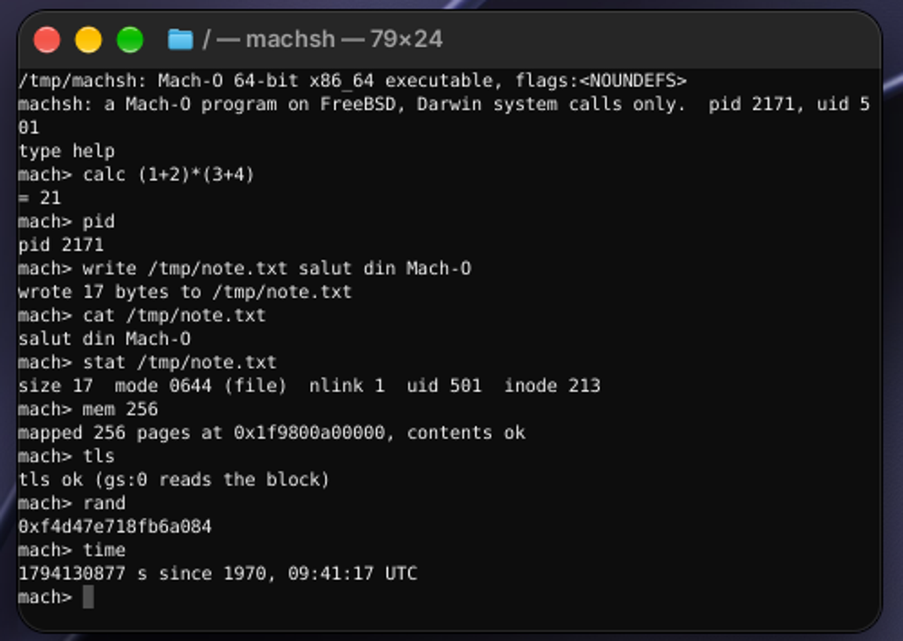
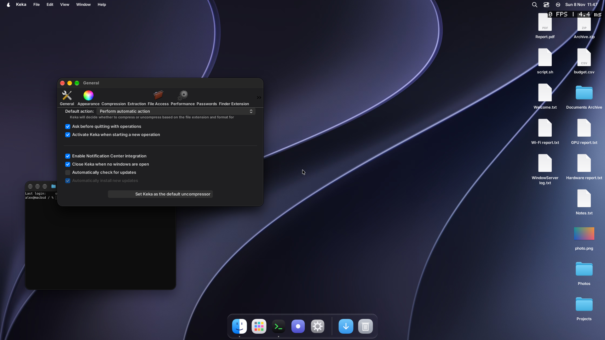
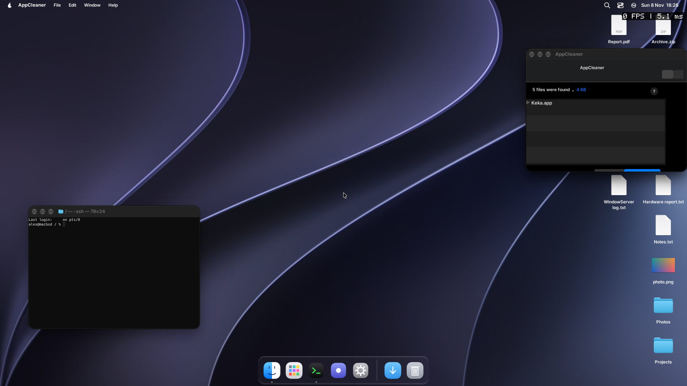
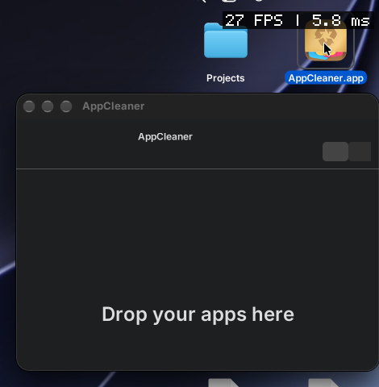
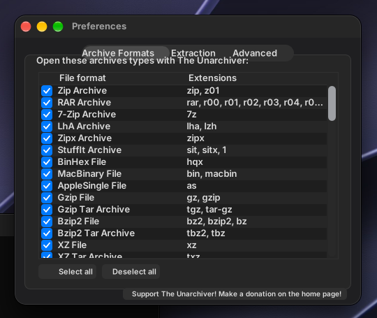

# darwinator

A FreeBSD kernel module that runs **Mach-O executables** (the program format of macOS) directly, on **arm64 and amd64**.

It is to Mach-O what `linux.ko` is to ELF programs of Linux: an image activator for the file format, plus a second system call table (the Darwin numbers and conventions) that a process gets when it is started from such a file. Native FreeBSD processes are not touched. The module is written for pearOS ([github.com/pearOS-bsd](https://github.com/pearOS-bsd)); `iso/build.sh` of wsbsd can fetch and build it like `virtio_gpu` and `clevo_dchu`.

Written from the public description of the Mach-O format and the system call conventions; no Apple source code is copied.



*`file` on a Mach-O program, then the program (`tests/c/machsh.c`) running interactively in the Terminal of the pearOS image (QEMU/KVM): it reads and writes files, maps memory, asks the time and the kernel's entropy with Darwin system calls only.*



*The Preferences window of Keka, the original Mach-O application from its release, started through `machrun` in the pearOS image: GNUstep's AppKit on the window server, Apple's compiled nibs, Objective-C classes of the program in libobjc2.*



*AppCleaner 3.7, an original Mach-O application of macOS 15 (Objective-C, chained fixups, Xcode 16 nibs, Sparkle), in its main window in the pearOS image. It starts, finds the files that an application leaves in `~/Library` and removes them (`tests/appcleaner.sh`, 13 checks); the window lists what it found, with the name of the application and the size (rows without icons or checkboxes yet: `docs/APPCLEANER.md`).*

## State

| | |
|---|---|
| Mach-O loader (`src/macho.c`) | thin and fat (universal) 64 bit files for the architecture of the kernel; `LC_SEGMENT_64` segments are mapped (`__PAGEZERO` skipped), entry point from `LC_MAIN` or `LC_UNIXTHREAD`, executable stack setup by the kernel (`argc`, `argv`, `envp`) |
| System calls (`src/syscalls.c`, `src/syscalls_more.c`, `src/syscalls_event.c`, `src/syscalls_posix.c`, `src/syscalls_sync.c`, `src/syscalls_compat.c`, `src/syscalls_proc.c`, `src/syscalls_spawn.c`, `src/syscalls_sem.c`, `src/syscalls_misc.c`, `src/mach_ipc.c`) | BSD class, about 270 numbers (of the 455 of xnu's `syscalls.master`) and 22 Mach traps (Mach IPC between processes: `src/mach_ipc.c`; ports are kernel objects named per process, port sets (`mach_port_allocate` with the set right, `move_member`, receive on a set), semaphores (`semaphore_create` through the task port, the `semaphore_*_trap`s), rights (receive, send, send-once) move in messages (port descriptors, out-of-line memory, out-of-line arrays of ports), the task port answers `task_get_special_port`, `task_set_special_port`, `mach_ports_register`, `mach_ports_lookup`, `semaphore_create`, `mach_port_type`, `mach_port_get_attributes`, `task_info` (MACH_TASK_BASIC_INFO, TASK_BASIC_INFO_64, DYLD_INFO) and a set of calls that are accepted (suspend, resume, policies, exception ports, dyld image registration), the host port answers `host_info` (BASIC_INFO), `_host_page_size`, `mach_port_names` (id 3200: two out-of-line arrays), `mach_port_request_notification` (id 3213: dead-name (72, when the port dies) and no-more-senders (70, when no task has a send right any more; rights in messages that are still queued are not counted); the other variants are accepted and do nothing), `host_statistics` and `host_statistics64` (VM_INFO, VM_INFO64, CPU_LOAD_INFO; ids 216 and 219, computed from mach_host.defs with the C preprocessor (tools/migids.py), not yet checked on a Mac); the message ids come from the `.defs` of xnu (mach_port 3200, task 3400, thread 3600, host 200), a forked child inherits the special ports (the bootstrap port) and the registered ports, a port dies with the process that holds its receive right; what `launchd` does is a program of user space on top of this) of xnu's `syscalls.master`. Straight to FreeBSD's code: `exit read write close unlink chdir fchdir getpid getuid geteuid access kill getppid dup getegid getgid umask munmap mprotect dup2 fsync gettimeofday readv writev mkdir rmdir pread pwrite lseek ftruncate issetugid` and `fork wait4 execve setuid setgid seteuid setegid setreuid setregid getgroups getpgrp setpgid getpgid getsid setsid getpriority setpriority getrusage getdtablesize link symlink readlink rename chmod fchmod chown fchown chflags fchflags truncate flock mkfifo sync madvise mlock munlock select poll connect bind listen accept recvfrom getsockname getpeername shutdown`. With a translation of flags or structures: `open` (flags), `mmap` (flags), `stat64 fstat64 lstat64` (struct), `fcntl` (commands, `struct flock`, `F_GETPATH`, `F_FULLFSYNC`, `F_DUPFD_CLOEXEC`), `ioctl` (the 64 bit `struct termios`; every other request goes through), `pipe` (both descriptors in rax/rdx), `getdirentries64` (Darwin's `struct dirent`), `statfs64 fstatfs64` (and the old `statfs fstatfs` 157, 158 with their own layout, read on a Mac), `sigprocmask` (32 bit sets), `getrlimit setrlimit`, `msync`, `socket socketpair` (`AF_INET6` is 30), `sendto` (`MSG_NOSIGNAL`), `setsockopt getsockopt` (`SO_NOSIGPIPE`), `sysctl sysctlbyname` (a read-only set: `hw.ncpu hw.memsize hw.pagesize hw.machine hw.model hw.physmem kern.ostype kern.osrelease kern.version kern.osversion kern.hostname kern.argmax`), `getentropy`, and from `syscalls_event.c`: `kqueue kevent kevent64` (Darwin's event structures, `EVFILT_USER` is -10 there, timer units; the Mach port and VM filters come back as error events), `sigaction` (with the trampoline argument, which is not used: the handler is called by the kernel's own trampoline with `(sig, siginfo*, ucontext*)`; on amd64 the ucontext is Darwin's, built beside FreeBSD's frame, on arm64 it is FreeBSD's) `sigaltstack sigsuspend sigpending pthread_sigmask setitimer getitimer`, `mknod getfsstat64 getattrlist` (name, type, ids, times, owner, mode, flags, file id, sizes) and the Darwin `dev_t` (major << 24 | minor) in `stat`, and `AF_INET6` addresses (`bind connect accept getsockname getpeername recvfrom`); and from `syscalls_posix.c`: the `*at` family (`openat fstatat64 faccessat fchmodat fchownat linkat unlinkat readlinkat symlinkat mkdirat renameat`, `AT_FDCWD` is -2 and the `AT_*` flags have other values), extended attributes (`getxattr setxattr removexattr listxattr` and the `f` forms, on FreeBSD's extattr in the user namespace), `ulock_wait ulock_wake ulock_wait2` (what `os_unfair_lock` and libdispatch wait on), `bsdthread_register bsdthread_create bsdthread_terminate` (a thread that starts at libpthread's routine with `(pthread, kport, func, arg, stack, flags)` in the argument registers; no workqueue), `psynch_mutexwait/mutexdrop/cvwait/cvsignal/cvbroad/rw_*` (a simplified kernel side: wake tokens per address, no interpretation of the generation words), `workq_open` (0) and `workq_kernreturn` (EINVAL: no workqueue), `thread_selfid`, `__pthread_kill` (by thread id), `csops`, `shared_region_check_np` (ENOMEM: no shared region); and from `syscalls_proc.c`: `sysctl KERN_PROC` (ALL, PID, PGRP, UID, RUID: `kinfo_proc` of 648 bytes with the offsets read on a Mac), `KERN_PROCARGS2` (argc, path, argv; no environment), `proc_info` (LISTPIDS; PIDINFO with `TBSDINFO`, `SHORTBSDINFO`, `TASKINFO`, `TASKALLINFO`, `PIDPATHINFO`), `kevent_qos` and `kevent_id` (events of 72 bytes; fd -1 and the workloop ids are kqueues of the process made on first use); and from `syscalls_misc.c`: POSIX AIO (`aio_read aio_write aio_fsync lio_listio aio_return aio_error aio_cancel aio_suspend`: the I/O is done inside the call, the result is kept until `aio_return`; no signal at completion), `__semwait_signal` (334, 423, on the Mach semaphores), `terminate_with_payload`, `abort_with_payload`, `pid_suspend`, `pid_resume`, `open_dprotected_np`, `initgroups`, `memorystatus_available_memory`, and EPERM for the system management calls (`mount unmount reboot acct swapon quotactl ...`); `fileport_makeport` and `fileport_makefd` (an open file as a Mach port that can travel in a message), and from `syscalls_sem.c`: named semaphores `sem_open sem_close sem_unlink sem_wait sem_trywait sem_post` (on FreeBSD's `sem.ko`, which the module depends on; the handle is the ksem id) and `access_extended` (no ACLs); and from `syscalls_spawn.c`: `posix_spawn` (244: `fork1` stopped + a start function in the child that applies the file actions open/close/dup2/inherit/chdir/fchdir and the attributes SETPGROUP/SETSIGDEF/SETSIGMASK/SETSID/RESETIDS/SETEXEC, then `kern_execve`; the parent waits for the exec, so an exec error is the return value as on Darwin; port actions are ignored; checked by `tests/c/spawn.c`, 13 checks); and from `syscalls_compat.c`: the old 32 bit inode `stat lstat fstat fstatat getdirentries`, the `*_extended` calls (no ACLs), `recvmsg sendmsg preadv pwritev utimes pathconf mlockall ...`, System V `sem*/shm*/msg*`, POSIX `shm_open`, `waitid` and `pselect`, the guarded descriptors (the guard is ignored), `sendfile`, `__sigwait`, `gethostuuid`, `ptrace` for PT_DENY_ATTACH, success for hints that change nothing (`kdebug_*`, `iopolicysys`, `process_policy`), ENOTSUP for what APFS has and this system has not (`clonefileat`, `exchangedata`, `searchfs`, `setattrlist`, `getattrlistbulk` ...: programs check for it and go on), ENOSYS for the rest (audit, MAC, `necp`, nexus and channels, coalitions); and the `*_nocancel` numbers that libSystem uses (`read write open close wait4 recvfrom accept msync fcntl select fsync connect readv writev sendto pread pwrite poll`). errno numbers are translated on the way out. Machdep class: `thread_fast_set_cthread_self` (amd64). Everything else fails with `ENOSYS` |
| x86-64 convention (`src/darwin_amd64.c`) | `syscall`, class in the top byte of `rax` (BSD = `0x2000000 + n`), arguments `rdi rsi rdx r10 r8 r9`, carry flag = error |
| arm64 convention (`src/darwin_aarch64.c`) | `svc #0` (Darwin programs use `svc #0x80`, but the svc handler of FreeBSD 14 raises SIGILL for an immediate other than 0, and a module cannot change that: the tests use `svc #0`; real Mach-O programs on arm64 go through `machrun`), number in `x16`, arguments `x0-x7`, carry flag = error |
| Test programs | `tests/c/machsh.c`: an interactive shell written as a Mach-O program (calculator, files, `stat64`, `mmap`, time, entropy, thread pointer), built on FreeBSD with clang + lld and `tools/elf2macho.py` (`tests/build-c.sh`); `tools/mkmacho.py` writes the minimal ones by hand |
| Not yet | **dyld** (files with `LC_LOAD_DYLINKER` / `LC_LOAD_DYLIB` are refused with a message), arm64 thread pointer (TPIDRRO_EL0), **the rest of Mach** (notifications, port attributes, the MIG routines of the thread and the host and `task_info`; Mach IPC itself is here: see `src/mach_ipc.c`), `commpage`, a real `workq_*` (EINVAL), the generation words of `psynch` (not interpreted), the Darwin signal frame on arm64 (amd64 has it: the registers are in the Darwin `ucontext`; a change of them by the handler is not applied), no floating point state in that context, arm64e (PAC), `sysctl` beyond the set above (`KERN_PROC` and the like), `getattrlist` attributes of volumes and directories, `F_GETPATH` of a file not yet looked up by name |

Tested on FreeBSD 14.5 amd64 under KVM and on FreeBSD 14.5 arm64 under QEMU (the same 248 checks of `tests/c/syscalls.c`; the CI runs both on every push) (`tools/vm-test.sh`): the module builds with `-Werror`, loads, runs the Mach-O test files (`LC_MAIN`, `LC_UNIXTHREAD`, a universal file), refuses a file of the other architecture, and ELF programs and scripts still run; `kldunload` works. **arm64 compiles (syntax check against the 14.5 headers) but has not been run yet** (needs an arm64 FreeBSD: the Mac's HVF VM, or CI). The GitHub-hosted FreeBSD VMs of the CI job (`.github/workflows/ci.yml`) were unreachable at the time of writing (HTTP 504 when the action downloads its VM image).

## machrun: a dyld for FreeBSD (`dyld/`)

Mach-O programs that need dyld and libSystem (nearly every Mac program) run through `machrun`, a userland loader that maps the file, applies rebase/bind and binds the imports to FreeBSD's libc and libraries, with shims for what differs (`dyld/shims.c`, `dyld/cf.c`). No kernel module is needed for this path. The unmodified command line tools of Keka (xz, zstd, lz4, 7-Zip and bsdtar, with 37 checks) run and produce archives that the system tools read: see `docs/KEKA.md` and `tests/keka.sh`.

```
make -C dyld                      # builds dyld/machrun (FreeBSD)
dyld/machrun [-v] PROGRAM [args]  # -v: what is bound and what is missing
KEKA_DIR=.../Keka.app/Contents/MacOS sh tests/keka.sh
```

The list of what runs and how well is in `docs/COMPATIBILITY.md`; `sh tests/all.sh` checks it in the image (one command).

A double click on `AppCleaner.app` on the desktop of the image starts it through the Finder (`macapp`):



(Driven with `tools/qmp-click.py`: QEMU's monitor command `mouse_move` does not move the absolute tablet, QMP `input-send-event` does.)

The Unarchiver 3.11 (the original Mac application, Objective-C) shows its Preferences window and extracts zip, tar.gz, tar.bz2, tar.xz and 7z archives, reliably (it is started with `MACHRUN_IMMORTAL_STRINGS=1`, which makes `autorelease` of strings a no-op: without it a path of 27 to 33 characters makes it crash, the cause is an over-release not found yet) (`docs/UNARCHIVER.md`, `tests/unar.sh`).



XLD, a converter of audio files with plug-ins that are Mach-O bundles (`docs/XLD.md`, `tests/xld.sh`), converts WAV to FLAC and back, byte for byte. Dylibs that are Mach-O files (the frameworks of an application: FFmpeg, libmpv ...) are loaded too, with their dependencies, thread-local variables and initializers; `machrun -L LIB.dylib -x SCRIPT` calls their functions (`docs/IINA.md`, `tests/dylib-ffmpeg.sh`).

What recent applications need beyond that (AppCleaner is the test): `LC_DYLD_CHAINED_FIXUPS`, nibs in the `NIBArchive` format of Xcode 16 (converted to the keyed archive that GNUstep loads, `compat.m`), the constant literals of the compiler (`@[...]`, `@{...}`, `@1` as structures in the file), direct references to the program's own classes, `objc_alloc`, `objc_opt_new` and the other fast paths of newer compilers, libdispatch objects that the compiler retains with `objc_retain`, CoreGraphics and CoreFoundation from libopal and GNUstep corebase, and stand-ins for Sparkle, SF Symbols and asset catalogs.

## In the pearOS image

`wsbsd/iso/build.sh` fetches this repository, builds `dyld/` (machrun, `libmachcompat.so`, `libexctrace.so`) and the kernel module, and installs them: `/usr/local/bin/machrun`, `/usr/local/bin/macapp`, `/usr/local/libexec/wrapapp.sh`, `/usr/local/lib/libmachcompat.so`, `/boot/modules/darwinator.ko` (not loaded by default). `loader.conf` loads `imgact_binmisc`; the rc script `wsbsd_machrun` registers the Mach-O magic numbers (thin and universal) with it, so a Mach-O executable runs like any program (`./kekaxz --version`); `macapp /path/App.app` starts a whole application (the bundle is wrapped in `~/Library/Caches/machrun`, as GNUstep wants it). `machrun` sets what Objective-C programs need by itself (`MACHRUN_LENIENT`, `MALLOC_CONF=junk:true`; `MACHRUN_STRICT=1` turns the first off).

## Build and use

On FreeBSD 14 with the kernel sources (`/usr/src/sys`):

```
make SYSDIR=/usr/src/sys
kldload ./darwinator.ko
python3 tools/mkmacho.py --arch x86_64 -o hello      # or --arch arm64, --entry unixthread, --fat
./hello                                              # prints "hello from a Mach-O file", exit status 7
sysctl kern.darwinator.debug=1                       # log why a Mach-O file is refused
sh tests/run.sh                                      # the whole test (root)
sh tools/vm-test.sh                                  # the same, in the local KVM VM (~/fbsd-vm), from the development machine
kldunload darwinator                                 # EBUSY while a Darwin process lives
```

`tools/mkmacho.py` writes a tiny Mach-O file by hand (no toolchain, no Mac needed). A file built on a Mac works the same if it has no dynamic libraries:

```
clang -nostdlib -Wl,-e,_start -o hello hello.s       # code that calls write/exit with svc #0x80 / syscall
```

## Design

* The system call vector (`darwin_sysvec`) is a copy of the native one (taken from `init` at load time, because it is not exported on arm64): same registers, same stack, same signal page. Replaced: the table, the names, the argument fetching, the ABI flag; no ELF core dump.
* The activator follows `imgact_elf.c`: it returns -1 for files that are not Mach-O (so ELF and `#!` still work), an errno for files that are Mach-O but cannot run. Segments are mapped as anonymous memory and filled from the file, then given their final protection (no mapping is ever writable and executable).
* Only the call numbers and the register convention are Darwin's; the FreeBSD implementation behind a call is used where the arguments and results are the same.

## Next steps

1. Run the CI, fix what the real kernel shows.
2. The BSD calls that are left: the rest of `sysctl`, the Darwin signal frame. (Done: about 100 calls, see the table; `tests/c/syscalls.c` checks 214 things on amd64, also on arm64: FreeBSD 14.5 aarch64 under QEMU, with `svc #0` for the calls).
3. `commpage`, thread-local storage (`thread_fast_set_cthread_self`), `psynch` for pthread.
4. arm64 thread pointer (TPIDRRO_EL0); the rest of Mach (notifications, `mach_port_names` and the other MIG routines of `mach_port`, `task_threads`, `host_statistics`, the routines of the thread).  A `launchd` of user space (the registry behind the bootstrap port) on top of `mach_ipc.c`.
5. dyld: the shared region and the dyld shared cache, then a real `dyld`.
