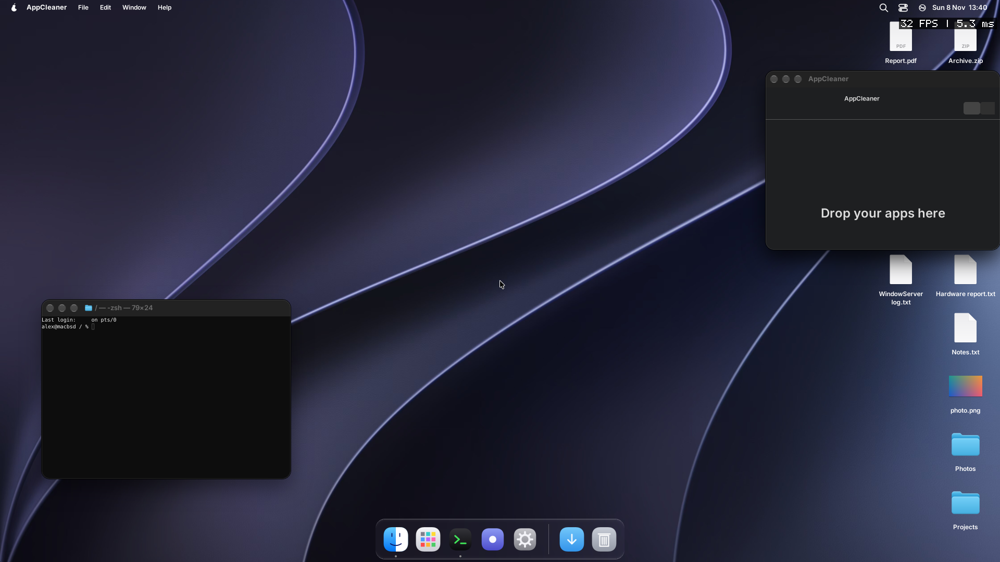

# AppCleaner 3.7 on pearOS

AppCleaner 3.7 (freemacsoft.net, the original `AppCleaner_3.7.zip`, built with Xcode 16 for macOS 15) is a second test for `machrun`, after Keka.
It is a small Objective-C program (400 KB), but built the way applications are built now.

Run it in the pearOS image: `macapp /path/AppCleaner.app` (or `machrun` on the bundle after `wrapapp.sh`).

## What it needed (all in `dyld/`)

| Gap | Where |
|---|---|
| `LC_DYLD_CHAINED_FIXUPS` (pointer formats `DYLD_CHAINED_PTR_64` and `_64_OFFSET`, imports with addends) | `machrun.c` `do_chained` |
| Compiled nibs in the `NIBArchive` format (the object graph of the old keyed archive, in a new container) | `compat.m` `machrun_nibarchive_to_keyed`, `tools/nibarchive.py` |
| Constant `@[]`, `@{}`, `@123` (`__objc_arrayobj`, `__objc_dictobj`, `__objc_intobj`, classes `NSConstantArray` ...) | `compat.m` |
| Sends to a class by the address of its structure in the file (`lea rdi,[_OBJC_CLASS_$_Foo]`) | `objc.c` `machrun_fix_recv`, in the trampolines |
| `objc_alloc`, `objc_alloc_init`, `objc_opt_new`, `objc_opt_class`, `objc_opt_isKindOfClass`, `objc_opt_respondsToSelector`, `objc_unsafeClaimAutoreleasedReturnValue` | `objc.c` |
| libdispatch queues retained with `objc_retain` (they are Objective-C objects on a Mac) | `objc.c` `is_dsp` |
| `os_log`, `UTType` constants, `__NSArray0__struct`, `__kCFBooleanTrue`, `setattrlist` | `shims.c`, `objc.c` |
| CoreGraphics = libopal, CoreFoundation = GNUstep corebase, QuartzCore | `shims.c` `shim_open_library` |
| Sparkle's `SUUpdater` in the main nib, SF Symbols and `Assets.car` images (empty images), `-1` as "no selection" in `NSSegmentedControl`, images of size 0 | `compat.m` |
| The activity indicator built from Core Animation layers (`DJActivityIndicator setColor:` does nothing) | `objc.c` `program_patches` |

## Where it stops

The main window opens ("Drop your apps here") and the application takes a dropped or opened application (`MACHRUN_OPENFILE=/path/App.app`) without an exception, but the list of its files is not shown: the scan runs on libdispatch queues and the result is not drawn.
Open: the images of `Assets.car` (no CoreUI reader), PDF images (`DropApp.pdf`), Sparkle as a library, a crash in `objc_msgSend` that was seen once at start and not again.
