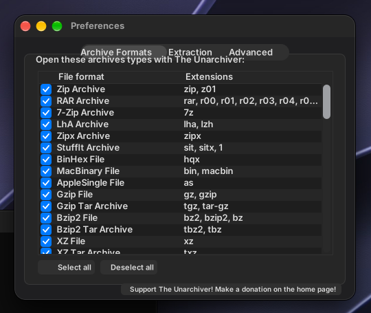

# The Unarchiver 3.11 on pearOS

The Unarchiver 3.11.1 (theunarchiver.com, the original `TheUnarchiver.zip` of the site's CDN) is the fourth application of the tests: Objective-C,
64 bit x86-64, no Swift. (The 4.x versions of MacPaw use the Swift runtime: they are not for this system yet.) It opens and extracts ZIP, RAR,
7-Zip, tar.gz, tar.bz2, tar.xz, StuffIt, LhA and about fifty other formats with its own libraries (`XADMaster.framework`, `UniversalDetector.framework`).

Install and run it in the pearOS image: `macapp-install unarchiver`, then `macapp "/Applications/The Unarchiver.app"` (the Preferences window) or
`macapp "/Applications/The Unarchiver.app" archive.zip` (what a double click on an archive does: it extracts it next to the archive).

## What it needed

| Gap | Where |
|---|---|
| LaunchServices: `LSCopyDefaultRoleHandlerForContentType` (answers with the application's own identifier: the Preferences window compares it with that), `LSCopyAllRoleHandlersForContentType`, `LSCopyApplicationURLsForURL`, `LSSetDefaultRoleHandlerForContentType`, `UTTypeCopyPreferredTagWithClass`, `GetCurrentKeyModifiers` | `shims.c` |
| `application:openFile:` (the single file form of the delegate, used by `MACHRUN_OPENFILE`) | `objc.c` |
| It crashes in `objc_autoreleasePoolPop` with `MALLOC_CONF=junk:true` (the default for Mac programs, see `machrun.c`); `macapp` starts it with `junk:false` | `tools/macapp` |

## Test

`sh tests/unar.sh "/Applications/The Unarchiver.app"` makes archives of a small tree (tar.gz, tar.bz2, tar.xz; zip and 7z too with `PREBUILT=dir`),
has the application open each one and compares the extracted files with the originals byte for byte.
